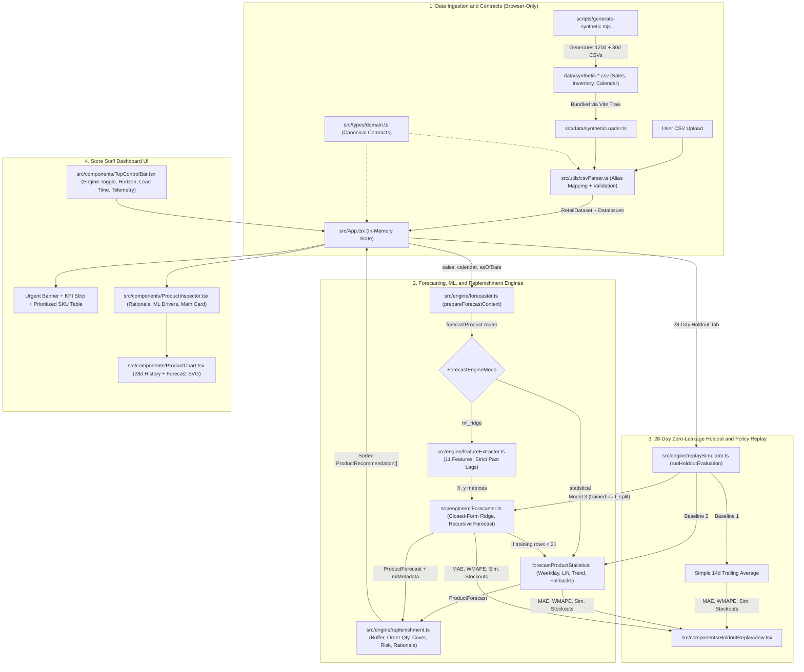

# System Architecture: Retail Smart Stock & Replenishment Advisor

This document describes the end-to-end architecture of the **Retail Smart Stock & Replenishment Advisor** (`Quantum`), combining the browser-only React + TypeScript application specified in `master_agent_build_guide.md` with the client-side Ridge Regression AI/ML forecasting layer.

---

## 1. Architecture Diagram

---

## 2. Layer Breakdown

| Layer | Key Files | Responsibility |
| :--- | :--- | :--- |
| **Data & Schemas** | `src/types/domain.ts`, `src/utils/csvParser.ts`, `src/data/syntheticLoader.ts`, `src/utils/dateUtils.ts`, `scripts/generate-synthetic.mjs` | Canonical TypeScript contracts, alias-resilient CSV parsing, cross-file linkage validation, UTC date math, and deterministic synthetic CSV generation (120d history + 30d future calendar). |
| **Forecasting & ML** | `src/engine/forecaster.ts`, `src/engine/featureExtractor.ts`, `src/engine/mlForecaster.ts` | Zero-leakage context prep (`row.date < asOfDate`), statistical heuristic (comparable-weekday baseline, event lift, bounded trend, sparse fallbacks), 11-feature extraction, closed-form Ridge Regression ($\lambda = 1.0$, unpenalized intercept), recursive multi-step forecasting, and automatic fallback when training rows $< 21$. |
| **Replenishment & Risk** | `src/engine/replenishment.ts` | Safety buffer ($S_p$), suggested order quantity ($Q_p$), days of cover ($C_p$), Urgent/Watch/Healthy/Excess + perishable spoilage risk classification, tie-breaking sort, and plain-language rationale with learned ML drivers. |
| **Holdout & Replay** | `src/engine/replaySimulator.ts`, `src/components/HoldoutReplayView.tsx` | 28-day zero-leakage 3-way benchmark (Simple 14d Average vs. Statistical Heuristic vs. Ridge ML trained strictly on `date <= t_split`) and simulated inventory policy replay. |
| **Dashboard UI** | `src/App.tsx`, `src/components/TopControlBar.tsx`, `src/components/ProductInspector.tsx`, `src/components/ProductChart.tsx`, `src/index.css` | Engine mode toggle, horizon (`7d`/`14d`/`30d`) and lead-time controls, live ML training telemetry, urgent alert banner, KPI strip, searchable SKU table, ML feature-driver breakdown, transparent math card, and SVG history/forecast chart. |

---

## 3. Core Architectural Constraints

* **100% Client-Side Execution:** All CSV parsing, Ridge Regression training, forecasting, replenishment math, and 28-day replay run locally in the browser with zero backend servers, databases, or external API calls.
* **Zero Data Leakage:** Forecast contexts and feature extraction strictly filter sales to `date < asOfDate`. In the 28-day holdout, Ridge ML models are trained strictly on `date <= t_split`.
* **Automatic Sparse-History Fallback:** SKUs with fewer than `21` valid non-stockout training rows automatically fall back to `forecastProductStatistical` and surface a `Statistical Fallback (Sparse History)` badge.
* **Honest Labeling:** Forecasts are labeled as demand estimates (with historical `quantity_sold` as demand proxy) rather than calibrated stockout probabilities, and inventory replay results are explicitly disclosed as simulated.
